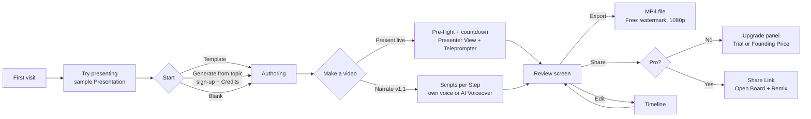
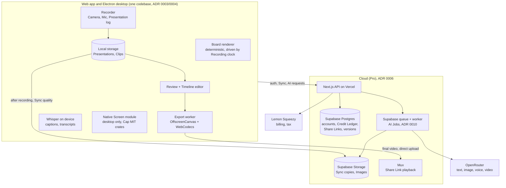

# Flowcam product spec

Flowcam is a studio for explainer creators and online teachers. A user builds a hand-drawn Presentation, presents it step by step while their face, voice and screen are recorded, and polishes the result into a professional video. Capitalised terms (Presentation, Step, Clip…) are defined in [CONTEXT.md](../CONTEXT.md); architectural decisions are in [docs/adr/](adr/).

Status: agreed design, 17 October 2026. No code yet.

## 1. Who it is for and why it wins

**Market:** worldwide, English first, priced in USD. The founder being based in Bangladesh affects only payments, payouts and app signing (see MONEY-FLOW.md (private: kept locally, not in the public repo)); Bangla Board fonts are a bonus for one local community, not the target market.

**Target users at launch:** developer advocates and engineers explaining systems, teachers and course creators, explainer YouTubers. Individuals only; team Workspaces come later.

**The wedge:** no product combines authored, step-by-step diagram animation with a synchronized facecam. The nearest rivals are each one feature away (ExcaliRec has a facecam but no authored reveals; Excalimate has reveals but no camera), so speed to launch matters.

**Three things only Flowcam can do, because a Presentation is recorded as data, not pixels (ADR 0002):**

1. Fix a typo or retime a Step after recording, without re-shooting.
2. Re-export at any resolution or Theme, including a vertical 9:16 version that re-lays-out the Board instead of cropping it.
3. Let viewers open the Board behind a Share Link and Remix it into their own account.

## 2. Features by release

### v1 — launch (web only)

**Authoring**
- Excaliflow's hand-drawn renderer, ported (ADR 0001): handwritten fonts (including Bangla-capable Atma and Galada), sketch fills, an expanded shape library, sticky notes, freehand, text.
- Arrows are static or have their Flow switched on, per arrow.
- Images by upload, paste, drag-in or URL; copied into storage so links never break.
- Presentations as a deck of Boards with Transitions; Focus Steps zoom in on part of a Board (ADR 0012).
- 4–6 Themes; about 10 Templates (lessons, explainers, system design).
- Steps created automatically from drawing order, refined in a Steps panel: reorder, merge, change effect (reveal, draw-on, morph, highlight, Flow on/off, Focus), delete.
- Excalidraw import (`.excalidraw` → Board). No export back.

**Recording (Presented Recordings)**
- Camera, Microphone and the Presentation as separate Tracks; each Clip saved to browser storage as it records.
- Pre-flight camera and mic check with level meters; 3-2-1 countdown.
- Presenter View: the Board being recorded, plus the current Script, next-Step preview and Clip timer, visible only to the presenter.
- Teleprompter strip under the webcam.
- Keyboard: → next Step, ← previous Step, `I` Ink, `Space` pause (starts a new Clip), `R` Retake.
- Ink: temporary marks that clear on the next Step.
- Layouts (Camera Bubble, side by side, Camera only, Board only) with Auto-placement; a Step can carry a Layout set during Authoring.
- Clips and Retakes; the Presentation resumes from the Step where the retaken Clip began.

**Review and editing**
- Review screen after Stop: plays back with dead air trimmed and captions generated (both reversible); actions Export, Share, Edit on Timeline.
- Timeline: Clips in order, each Step a draggable block; trim, split, speed, delete a range; Transitions between Clips; Layout changes anywhere.
- Backgrounds, padding and shadows around the frame.
- Noise reduction and loudness levelling, on device.
- Captions from on-device Whisper (free for everyone); caption styles and positioning; SRT/VTT export.

**Export and sharing**
- MP4 export rendered on the device. Free: watermarked, up to 1080p. Pro: no watermark, up to 4K.
- Share Links (Pro): Mux player, "Open Board" with Remix, AI chapters, transcript, embed code, optional password, view count with "someone watched" emails.
- Sync (Pro): Presentations and Recordings across devices; resume editing on the web. Conflicts never overwrite silently: "Keep both" or "Use the cloud version".

**AI (Credits)**
- Generate a Presentation from a topic or a pasted document.
- Generate Scripts.
- Titles, summary and chapters for Share Links.

**Onboarding and billing**
- First visit lands in a sample Presentation with **Try presenting**; then Template, Generate from a topic, or Blank. No account needed except for AI and Pro.
- Pro features visible with a Pro badge; clicking opens an upgrade panel about that feature, with the Founding Price while the launch window is open.
- 7-day Pro Trial with a card, 200 Credits.
- Billing through Lemon Squeezy as merchant of record (ADR 0014).

### v1.1

- **Narrated Recordings:** each Step plays its own Narration — your own voice recorded per Step while reading the Teleprompter (free), an AI Voiceover piece (Credits), or silence for a set time. Editing a Script regenerates only that Step's piece.
- **Script upload:** a document is split across Steps by paragraph (a `---` line forces a break); "Match with AI" assigns passages to the right Steps (about 2 Credits); dividers can be dragged by hand.
- AI image generation.
- Transcript editing and filler-word removal (Pro, on device, no Credits).
- Basic web Screen recording.
- Background music with automatic ducking; intro and outro cards from the Theme; text overlays and animated text; crop and image overlays; colour presets for the camera.
- Vertical (9:16) and square (1:1) export with automatic re-layout.

### v1.2

- macOS and Windows apps (Electron, ADR 0004) with Screen Polish (Pro): auto-zoom with spring motion, cursor smoothing and styles, keyboard overlays, blurred regions; system audio; global hotkeys; a Camera Bubble floating over other apps.
- **Distribution (ADR 0019):** downloaded from Flowcam's website. macOS signed with an Apple Developer ID and notarised; Windows signed with a cloud-key code-signing certificate (SSL.com Individual Validation or Certum). Updates download in the background from Cloudflare R2 and install on quit; a beta channel for testers.
- **Native capture:** a Rust module linked into Electron, reusing Cap's MIT screen and camera crates, loaded only when recording a Screen.
- **Supported systems:** macOS 13 Ventura or later (one app for Apple Silicon and Intel); Windows 10 and 11, 64-bit first, Windows on ARM later.
- **First launch:** a guided permissions screen (Screen Recording, Camera, Microphone) with "Open System Settings" buttons, explaining the restart macOS needs after granting Screen Recording.
- **Sign-in:** through the browser, handed back to the app with a `flowcam://` link; free local use works offline with no sign-in.
- **Desktop extras:** global hotkeys, a floating Camera Bubble, and a menu-bar (Mac) or tray (Windows) icon for quick recording.
- Video Elements on Boards, uploaded or generated from a picture (Credits).

### Later

AI avatar in the Camera Bubble · snapshot morphing between Board states · Keyframe fine-tuning · Voice Patches · Cutaways · switching between Presentation and Screen within one Recording · cinematic camera shots · timestamped comments · Workspaces · Linux · mobile.

### Not planned

Real-time co-editing of a Board · free multi-track editing · exporting back to Excalidraw.

## 3. Key user flows

## 4. Interface design

- **Look:** a calm, neutral studio (greys, one accent colour), with Cap's interface as the visual reference, recreated in our own code (ADR 0013, 0018). Hand-drawn personality appears only in the logo, empty states, onboarding and marketing, so the user's Board is the only expressive thing on screen.
- **Authoring layout (Keynote-style):** top bar with Presentation name, Theme, Try, Record and Share; Boards strip on the left; canvas in the centre with Excaliflow's floating drawing toolbar; right panel with Style, Steps and Script tabs. Both side panels collapse.
- **Review and Timeline editor (Cap-style):** large preview on top, Timeline of Clips and Steps along the bottom, settings sidebar with tabs (Background, Camera, Audio, Captions, Layout).
- **Stack:** TypeScript; React with Tailwind CSS and shadcn/ui; Zustand for editor state; the Board renderer is plain TypeScript on canvas with no React inside (ADR 0018).
- **Light and dark:** the interface follows the system setting with a manual switch; a Board's Theme is independent of it.
- **Accessibility:** WCAG 2.2 AA; everything operable by keyboard, including Steps, recording and the Timeline; the interface respects "reduce motion" while users' own Flows and Transitions still render; captions on by default.
- **Languages:** English is the main language for the interface, marketing and support, with all text in translation files from day one. Boards support Bangla at launch with the handwritten-style Atma and Galada fonts (Google Fonts), picked automatically by Themes when Bangla text is detected; Bangla captions and AI voices are marked beta.
- **Devices:** authoring and recording in desktop Chrome, Edge, Firefox and Safari 16.4+; tablets for watching and, later, presenting; phones for watching Share Links and opening Boards read-only.
- **Design process:** the five key screens (Authoring editor, Presenter View with Teleprompter, Review and Timeline editor, Share Link page, pricing and upgrade panel) are designed in Figma first; design tokens live in code as the single source of truth; all other screens are designed directly in code.

## 5. Plans, pricing and Credits

| | Free | Pro |
|---|---|---|
| Price | $0 | $20/month or $200/year. **Founding Price $17/month or $170/year**, locked in for subscribers who join in the first 3 months or among the first 500, whichever comes first (ADR 0008) |
| Storage | Local only (ADR 0005) | Cloud: Share Links, Sync, 100 GB Storage Quota (Sync uploads pause when full; nothing deleted) |
| Export | Watermark, up to 1080p | No watermark, up to 4K |
| Screen Polish | — | Yes (desktop) |
| Credits | 50 once at sign-up | 1,000 per month (granted monthly on yearly plans too) |
| Trial | — | 7 days with a card, 200 Credits |

- **All prices exclude tax:** sales tax and VAT are added at checkout by Lemon Squeezy (see MONEY-FLOW.md (private: kept locally, not in the public repo)).
- **Top-ups:** 1,000 Credits for $10; never expire.
- **Bonus Credits** (offers, referrals, apologies): expire 90 days after being granted.
- **Spending order:** monthly allowance, then Bonus Credits, then Top-ups.
- **Cancelling:** for anyone who has paid at least once, Share Links keep working; cloud items become view-only and downloadable. Share Links made during a Trial that ends unpaid stop working, after a warning on the Trial screen and an email two days before it ends.

**Credit prices per AI Job** (1 Credit = $0.01 retail; about 3× cost):

| AI Job | Standard | Best |
|---|---|---|
| Generate a Presentation | 5 | 15 |
| Script | 1 | 6 |
| Match uploaded Script to Steps | ~2 | — |
| Image | 12 | 45 |
| Voiceover, per minute | 1 | 6 |
| Video, per 5 seconds (1080p) | 75 | 300 |
| Titles, summary, chapters | free with Share Links | — |

Video prices come from OpenRouter's video models API (`/api/v1/videos/models`), read 17 October 2026.

## 6. Architecture

**Core decisions**

| Area | Decision | ADR |
|---|---|---|
| Codebase | New monorepo; Excaliflow renderer ported (keep Apache-2.0 attribution) | 0001 |
| Presentation capture | Timestamped data log replayed at export; rendering must be deterministic; Images copied into storage | 0002 |
| Platforms | Web first; desktop adds only native Screen capabilities | 0003 |
| Desktop shell | Electron, with native capture behind a narrow module boundary | 0004 |
| Free vs cloud | Free is local-only; every cloud capability is paid | 0005 |
| Stack | Vercel, Supabase (Postgres, Auth, Storage), Mux, OpenRouter (server only) | 0006 |
| Billing | Lemon Squeezy as merchant of record; Stripe via a US company later | 0014 |
| Viral links | 10,000-minute Viewing Allowance, overflow to MP4 on Cloudflare R2 | 0015 |
| Idle links | Cooled from Mux to MP4 on R2 after 90 days without views | 0016 |
| Spend protection | Provider caps plus our own daily budgets and circuit breakers | 0017 |
| Desktop distribution | Direct download; Apple notarisation; cloud-key Windows certificate; updates from R2 | 0019 |
| Analytics | PostHog, cookieless, event names only; revenue from Lemon Squeezy webhooks | — |
| AI routing | Our own route per AI Job: cheap model on `:floor`, escalate on failed check, fallbacks; Quality setting | 0007 |
| Pricing | $20 list, $17 Founding Price locked for life | 0008 |
| Uploads | Once after recording; Sync quality ≈ 20 MB/min; final video browser → Mux | 0009 |
| AI Jobs | Supabase queue with retries, notifications and storage cleanup | 0010 |
| Credits | Append-only Credit Ledger with Holds | 0011 |
| Presentations | Deck of Boards with Focus Steps | 0012 |
| Editor | Match Cap's features in our own code; reuse only Cap's MIT capture crates | 0013 |

**AI routing**

| AI Job | Standard route | Escalation / Best | Est. cost |
|---|---|---|---|
| Generate a Presentation | `google/gemini-3.1-flash-lite:floor` | `anthropic/claude-sonnet-5.5` | ≈ $0.015 avg / $0.05 |
| Script | `google/gemini-3.1-flash-lite:floor` | `anthropic/claude-sonnet-5.5` | ≈ $0.003 / $0.02 |
| Titles, summary, chapters (one call) | `google/gemini-3.1-flash-lite:floor` | — | ≈ $0.002 |
| Image | `google/gemini-3.1-flash-lite-image:floor` | `google/gemini-3-pro-image` | ≈ $0.04 / $0.15 |
| Voiceover | `hexgrad/kokoro-82m` or `fish-audio/drama-3` | `elevenlabs/eleven-flash-v2.5` | ≈ $0.001–0.002 / $0.018 per min |
| Video (5 s, 1080p, no audio) | `google/veo-3.1-lite`, fallbacks `grok-imagine-video-1.5-lite`, `kling-v3.0-std` | `google/veo-3.1`, fallback `kling-v3.0-pro` | $0.25 / $1.00 |

Model IDs and prices were read from OpenRouter's models API on 17 October 2026; revisit Credit prices whenever a route's model changes. Cost savers: one call for titles/summary/chapters, fixed instructions first for prompt caching, results reused for unchanged input.

**Other rules**

- **Credits:** a Hold is placed and checked in one transaction at submission; charge on success, release on failure; a Standard Job that escalates is still charged its fixed price.
- **Storage cleanup:** Job inputs and in-between files deleted on completion; a Free user's result deleted once downloaded (7 days at most); Pro results kept; daily sweep of leftovers.
- **Abuse limits (conservative):**
  - **Sign-up grant:** given only after email verification and a first Presentation.
  - **Checks:** Cloudflare Turnstile on sign-up and on every AI Job from a Free account. Disposable email domains are blocked, and Gmail-style aliases count as one address.
  - **One grant per** device and network address in 24 hours.
  - **Limits by plan:**

    | Plan | Jobs at once | Job limit | Video Jobs |
    |---|---|---|---|
    | Free | 1 | 10 per day | none with sign-up Credits |
    | Trial | 2 | 30 per hour | at most 3 |
    | Pro | 3 | 60 per hour | at most 20 per day |

  - **Repeat offenders:** accounts that repeatedly hit limits are frozen for AI use and flagged for manual review. Their data is untouched.
- **Sync conflicts:** every save carries its base version; a stale save is refused and the user chooses.
- **Performance:** export in a background worker with hardware encoding; Clips saved as they record; Images deduplicated by content hash and resized for display (original kept); recorder, Timeline and Whisper loaded on first use; native Screen module loaded only when recording a Screen.

## 7. Scaling plan

Heavy work (drawing, recording, export rendering, transcription) runs on users' devices, so the servers mainly handle accounts, small files and AI Jobs. Launch as designed; change a component only when its trigger is reached, with the budget alerts from ADR 0017 giving warning.

| What strains | From day one | Trigger | Upgrade |
|---|---|---|---|
| Database connections | Supabase connection pooler | — | — |
| AI Job worker | Concurrency capped at OpenRouter rate limits | Queue wait over 30 s at peak | More workers, or a dedicated worker service |
| File storage and transfer | Supabase Storage, resumable uploads, 100 GB Storage Quota per Pro user | Storage + transfer over $300/month | Move Sync files to Cloudflare R2 |
| Video playback | Mux, with R2 for overflow (ADR 0015) and Cooling (ADR 0016) | Mux bill over $1,000/month | Volume pricing, or compare Cloudflare Stream |
| Web app and API | Vercel | Vercel bill over $500/month | Move the API to Cloudflare Workers |
| Analytics | PostHog free tier | Over 1 million events/month | Sample non-funnel events |

## 8. Unit economics

Typical Pro user per month: AI ≈ $0.80 (about half the allowance), Mux ≈ $1.00, Supabase ≈ $0.40, Lemon Squeezy ≈ $1.60–1.85 at $17 (5% + 50¢, +1.5% international, +0.5% subscriptions, 1% per payout outside the US; see MONEY-FLOW.md (private: kept locally, not in the public repo)). Free users cost almost nothing beyond the $0.17 sign-up grant.

| | Founding $17 | List $20 |
|---|---|---|
| Contribution per user | ≈ $13.00 (76%) | ≈ $15.70 (79%) |
| Worst case (all Credits used) | ≈ $10.40 (61%) | — |

Fixed costs ≈ $90/month (Vercel Pro, Supabase Pro, Apple Developer, Windows code signing, domain and email; from memory, not re-checked).

| Pro users | Monthly profit before salary (Founding Price) |
|---|---|
| 7 | break-even |
| 500 | ≈ $6,400 |
| 1,000 | ≈ $12,900 |

### First-year cost plan

Tracked month by month and by topic, with actuals filled in from invoices, in ADR 0020 and docs/cost-tracker/ (private: kept locally, not in the public repo).

Excludes the founder's salary, computer and development tools. Fixed prices are from memory and should be checked when opening accounts.

| Phase | What you pay | Cost |
|---|---|---|
| Build, about 3 months before launch | Domain (~$15 once), business email (~$7/month), OpenRouter testing (~$20/month); Vercel, Supabase, Mux, PostHog, R2 and Cloudflare on free tiers | **≈ $100 total** |
| Every month from launch | Vercel Pro $20, Supabase Pro $25, email $7 | **$52/month fixed** |
| Per Pro user | AI ≈ $0.80, Mux ≈ $1.00, Supabase ≈ $0.40, plus Lemon Squeezy ≈ $1.85 deducted from revenue | ≈ $4.05 of each $17 |
| Per new free user / Trial | Sign-up grant ≈ $0.04 on average; Trial ≈ $0.30 | variable |
| v1.2 desktop launch, once a year | Apple Developer $99 + Windows certificate ≈ $230 | **≈ $329/year** |
| Cash buffer | Prepaid OpenRouter credit (spent as used, ADR 0017) | $50 |

**Starting budget:** about **$700** covers the build phase, the OpenRouter buffer, the desktop certificates and about four months after launch even with zero paying users (≈ $90/month with free users' AI).

**Twelve months after launch** (Founding Price $17; Conservative assumes 500 new free users and 25 Trials a month, Target 1,000 and 60):

| Month | Conservative: Pro / net | Target: Pro / net |
|---|---|---|
| 1 | 5 / −$15 | 20 / +$149 |
| 2 | 12 / +$76 | 50 / +$538 |
| 3 | 20 / +$180 | 90 / +$1,056 |
| 4 (desktop costs) | 30 / −$20 | 140 / +$1,374 |
| 6 | 55 / +$633 | 270 / +$3,386 |
| 12 | 160 / +$1,992 | 900 / +$11,545 |
| **Year 1 total** | **≈ +$9,600** | **≈ +$55,600** |

Fixed costs stay at $52/month throughout both scenarios because no scaling trigger in §7 is reached; at the Target scenario's 900 Pro users, check the Supabase and Vercel bills against their triggers.

## 9. Open items and risks

Tracked, with deadlines and how to close each, in [OPEN-ITEMS.md](OPEN-ITEMS.md).

- **Sales tax:** handled by Lemon Squeezy as merchant of record (ADR 0014). Revisit a US company with Stripe Managed Payments once revenue justifies it.
- **Uploads:** Supabase Pro (global file limit raised to 5 GB) before the first paying user; all Tracks and exports use resumable uploads.
- **Viral Share Links:** a 10,000-minute monthly Viewing Allowance per Pro user on Mux, then overflow to plain MP4 on Cloudflare R2 (ADR 0015).
- **Conversion rate** is unknown; the 4% planning figure is a guess. Measured from launch with PostHog funnels; review after 60 days.
- **Copyability:** ExcaliRec or Excalimate could add the missing half; ship v1 fast.
- **Resuming on another device** exports the camera at Sync quality (about 1080p), noticeable only in full-screen camera Layouts.
